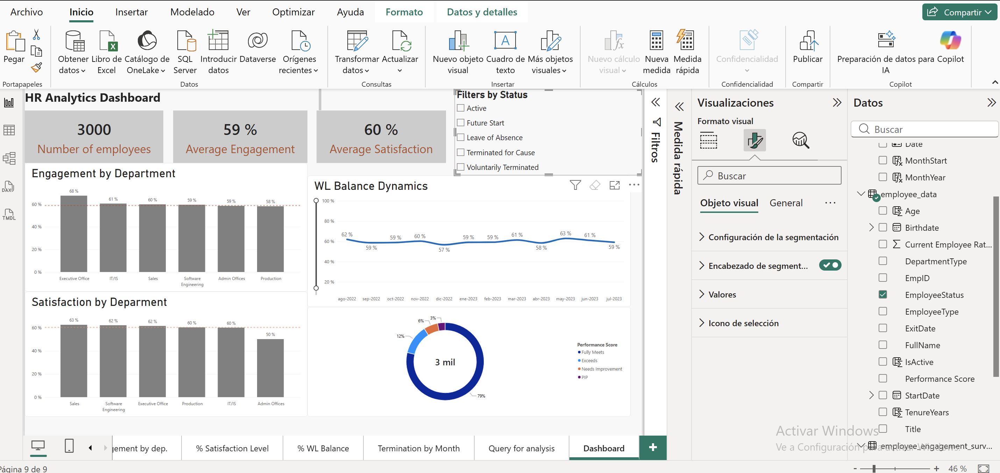

# 📊 HR Analytics Dashboard - Power BI

## 📌 Project Overview
This project presents an interactive Human Resources dashboard built in **Power BI** to monitor workforce metrics, employee engagement, satisfaction levels, and turnover trends. The goal is to provide HR leaders with actionable insights to improve talent retention and organizational culture.

## 🎯 Key Metrics (KPIs)
* **Total Employees:** 387
* **Average Engagement:** 58%
* **Average Satisfaction:** 62%

## 🔍 Key Insights & Analysis
* **Department Performance:** Evaluated engagement and satisfaction scores across different departments (Sales, IT, Software Engineering, etc.) to identify areas needing leadership support.
* **Work-Life Balance Dynamics:** Tracked historical trends to spot seasonal drops in employee well-being.
* **Attrition & Termination:** Analyzed employee status (Active, Voluntary Termination, Terminated for Cause) and performance scores to understand retention risks.

## 🛠️ Tools & Skills Used
* **Power BI Desktop:** Data modeling, DAX measures (`IsActive`, `Current Employee Rel`), and interactive visualizations.
* **Data Cleaning & Transformation:** Power Query.

## 📂 Repository Contents
* `HR_Dataset2.pbix` - Complete Power BI report file.
* `dashboard_preview.png` - Main dashboard visual overview.
